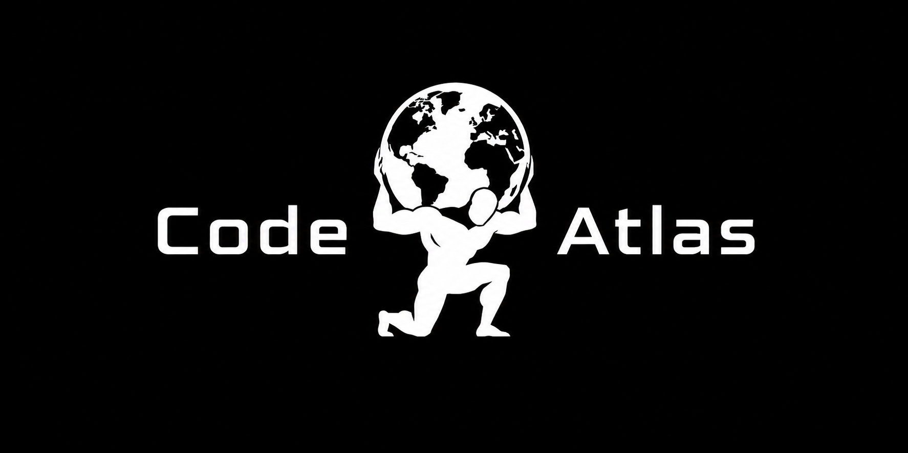

# CodeAtlas Extension

<p align="center">
  
</p>

**Status:** Pre-Alpha Testing, Active Development


> The browser companion for [CodeAtlas](https://github.com/Cir9no-0001/CodeAtlas): trigger LeetCode syncs, watch them run, and browse run logs from a full-tab dashboard without leaving Chrome.

---

## Table of Contents

- [Project Overview](#project-overview)
  - [What is this?](#what-is-this)
  - [Tech Stack](#tech-stack)
  - [Key Features](#key-features)
  - [Why was this built?](#why-was-this-built)
- [Design Decisions](#design-decisions)
- [Setup Guide](#setup-guide)
- [Repository Structure](#repository-structure)
- [How It Works](#how-it-works)
- [Implemented Features](#implemented-features)
- [Incoming Features](#incoming-features)
- [Limitations / Known Issues](#limitations--known-issues)
- [License](#license)

---

# Project Overview

## What is this?

CodeAtlas Extension is a Chrome extension that controls a CodeAtlas sync from the browser.

Instead of opening GitHub, finding the workflow, and pasting a fresh LeetCode cookie into repository secrets by hand, the extension:

- Reads your LeetCode session cookie directly from the browser
- Encrypts it and stores it as a GitHub Actions secret in your own repository
- Triggers the sync workflow and tracks it until it finishes
- Keeps a run log with the full GitHub Actions output for every sync
- Runs syncs automatically on a schedule, even with the dashboard closed

## Tech Stack

- **Platform:** Chrome Extension, Manifest V3
- **Language:** Vanilla JavaScript (ES modules), no build step
- **Background:** Module service worker with `chrome.alarms` scheduling
- **APIs:** GitHub REST API, `chrome.storage`, `chrome.cookies`
- **Encryption:** libsodium sealed boxes via TweetNaCl (`vendor/sealedbox.js`)
- **Content:** Legal docs and changelog fetched as Markdown from public GitHub repos

## Key Features

### One-Click Sync

- Power button starts a sync, click again to cancel
- Live status: Starting, Queued, Running, Done
- Survives closing the dashboard mid-run

### Run Log

- Every sync recorded with date, time, status and message
- Expand any finished run to load its full GitHub Actions log

### Auto-Sync

- Sync every 15 minutes, 1 hour or 24 hours
- Runs in the background service worker, no tab required

### Customization

- Default, Day and Night themes
- Custom background image with live preview

## Why was this built?

CodeAtlas worked, but using it didn't feel good.

Every sync meant a trip through GitHub's UI: open the repository, go to Actions, find the workflow, click Run, refresh until it finished, then dig through raw logs to see what happened. There was no clear way to see whether a sync was running, cancel one, or check the last time it worked.

The uncontrollable LeetCode cookie was the worst part. `LEETCODE_SESSION` expired like milk, and every time it did, the fix was to open DevTools, find the cookie, copy it, and paste it into the repository's secrets by hand. Miss that step and syncs failed quietly.

The extension was built to fix all three:

- **UI/UX:** one dashboard for syncing, status, logs and settings, instead of navigating GitHub's interface
- **Flow control:** start, cancel and watch a sync live, schedule automatic syncs, and keep a readable history of every run
- **Cookie handling:** the extension reads the current LeetCode session straight from the browser and refreshes the GitHub secret automatically on every sync, so it never goes stale

It is also the foundation for CodeAtlas's next stage. The dashboard already has the shape the backend version will need (accounts, a solutions database, settings), and the sync logic sits behind a swappable provider, so moving to a centralized backend changes one file instead of the whole extension.

---

<details>
<summary>Design Decisions</summary>
<a name="design-decisions"></a>

## Background Worker Owns the Sync

**Decision:** The service worker runs every sync. The dashboard only reads state from `chrome.storage` and sends start/cancel messages.

**Why:** Earlier versions ran the sync inside the dashboard tab, so closing the tab killed the run, auto-sync silently did nothing without an open tab, and log entries could get stuck on "running" forever. With one writer and storage as the single source of truth, the UI can never disagree with the actual run state.

**Trade-off:** Extension service workers are shut down after 30 seconds of inactivity, so the worker has to keep calling extension APIs while polling and must resume an interrupted run when it wakes back up.

## Swappable Sync Provider

**Decision:** All GitHub Actions-specific logic lives in `src/lib/providers/githubActions.js`, behind four functions: `startRun`, `getRunStatus`, `cancelRun` and `fetchRunLog`.

**Why:** CodeAtlas is moving to a centralized backend. When it ships, a new provider exporting the same four functions replaces this file, and the background worker and dashboard stay unchanged.

**Trade-off:** One extra layer of indirection while there is only a single provider.

## Client-Side Secret Encryption

**Decision:** The LeetCode cookie is encrypted in the browser with the repository's public key (a libsodium sealed box) before it is uploaded as a GitHub Actions secret.

**Why:** GitHub only accepts secrets encrypted this way. Only GitHub can decrypt the result, not even the extension, so the cookie never travels or rests in plain text.

## Least-Privilege Token

**Decision:** The extension asks for a fine-grained personal access token scoped to a single repository with only **Actions** and **Secrets** read/write.

**Why:** If the token ever leaked, it could not read or modify code, touch other repositories, or access account settings. Contents access is unnecessary because the workflow commits with its own `GITHUB_TOKEN`.

## No Build Step

**Decision:** Plain ES modules loaded directly by Chrome, with no bundler or framework.

**Why:** The extension is small enough that a build pipeline would add more complexity than it removes. What is in the repository is exactly what Chrome runs, which also keeps it readable for Chrome Web Store review, which prohibits obfuscated code.

</details>

---

<details>
<summary>Setup Guide</summary>
<a name="setup-guide"></a>

## Requirements

- Chrome 111 or newer
- A repository set up with [CodeAtlas](https://github.com/Cir9no-0001/CodeAtlas), including `.github/workflows/leetcode.yml` with a `workflow_dispatch:` trigger
- A LeetCode account you are logged into in Chrome

## Installation

```bash
git clone https://github.com/Cir9no-0001/CodeAtlas-Extension
```

1. Open `chrome://extensions`
2. Enable **Developer mode** (top right)
3. Click **Load unpacked** and select the `CodeAtlas-Extension` folder
4. Click the CodeAtlas toolbar icon to open the dashboard

## Creating a GitHub Token

1. GitHub -> Settings -> Developer settings -> Personal access tokens -> **Fine-grained tokens** -> Generate new token
2. **Repository access:** Only select repositories -> your CodeAtlas repository
3. **Repository permissions:**
   - Actions: Read and write
   - Secrets: Read and write
4. Generate and copy the token (GitHub only shows it once)
5. Paste it into the popup that opens on first launch, then pick your repository in the sidebar

Keep this token private. Revoke it at any time from the same settings page.

</details>

---

<details>
<summary>Repository Structure</summary>
<a name="repository-structure"></a>

```text
CodeAtlas-Extension/
├── manifest.json                  Extension config and permissions
├── assets/icons/                  Toolbar and store icons
├── vendor/sealedbox.js            Bundled TweetNaCl sealed-box encryption
└── src/
    ├── background.js              Service worker: runs and polls syncs
    ├── lib/
    │   ├── constants.js           Shared sync statuses and alarm name
    │   ├── github.js              githubFetch() wrapper for the GitHub REST API
    │   └── providers/
    │       └── githubActions.js   Sync via the user's GitHub Actions workflow
    ├── auth/                      Token popup
    └── dashboard/
        ├── dashboard.html/.css    Full-tab dashboard
        ├── main.js                Entry point: starts every panel
        ├── sync-panel.js          Power button, status, repo picker, auto-sync
        ├── log.js                 Run log tab
        ├── changelog.js           Changelog tab
        ├── legal.js               Legal tab, consent modal, Markdown renderer
        ├── settings.js            Themes and background image
        └── tabs.js                Tab switching
```

</details>

---

<details>
<summary>How It Works</summary>
<a name="how-it-works"></a>

1. **Start:** the power button (or an auto-sync alarm) sends `SYNC_START` to the service worker.
2. **Secret upload:** the worker reads `LEETCODE_SESSION`, fetches the repository's public key, encrypts the cookie and writes it as an Actions secret.
3. **Dispatch:** it triggers `leetcode.yml` on the repository's default branch. GitHub returns the new run's ID directly (`return_run_details`).
4. **Poll:** every 3 seconds the worker checks the run and writes the status to `syncState` and the run's log entry in `chrome.storage`.
5. **Render:** the dashboard listens for storage changes and updates the power button, status text and log in real time.
6. **Finish:** on success, `lastSynced` is updated. Expanding the log entry downloads the job's full output from GitHub.

If Chrome stops the worker mid-run, it resumes polling the next time it wakes. Opening the dashboard wakes it.

</details>

---

<details>
<summary>Implemented Features</summary>
<a name="implemented-features"></a>

- GitHub fine-grained token auth with repository picker
- LeetCode session detection
- Encrypted secret upload and workflow dispatch
- Background sync with live status and cancel
- Scheduled auto-sync
- Run log with expandable GitHub Actions output
- Changelog tab (from the main CodeAtlas repository)
- Legal tab and first-run consent (from [CodeAtlas-Legal](https://github.com/Cir9no-0001/CodeAtlas-Legal))
- Default, Day and Night themes, custom background image

</details>

---

<details>
<summary>Incoming Features</summary>
<a name="incoming-features"></a>

- Centralized backend: sync runs server-side, no personal access token required
- Sign in with GitHub or Google
- Database tab: browse every solved problem by difficulty, with editable notes
- Account and security settings, including MFA
- Custom themes
- Chrome Web Store release

</details>

---

<details>
<summary>Limitations / Known Issues</summary>
<a name="limitations--known-issues"></a>

- Requires a fine-grained personal access token until the backend ships
- The GitHub token is stored in `chrome.storage.local` on your device. Scope it to one repository as described above.
- The workflow file must be named `leetcode.yml`
- Each sync uses GitHub Actions minutes from your account
- Not yet published to the Chrome Web Store; install via Load unpacked

</details>

---

## License

Copyright (c) 2026 Stanley Chen. All Rights Reserved.

The source code is publicly viewable for evaluation and educational purposes only. See [LICENSE](LICENSE) for permitted use.
